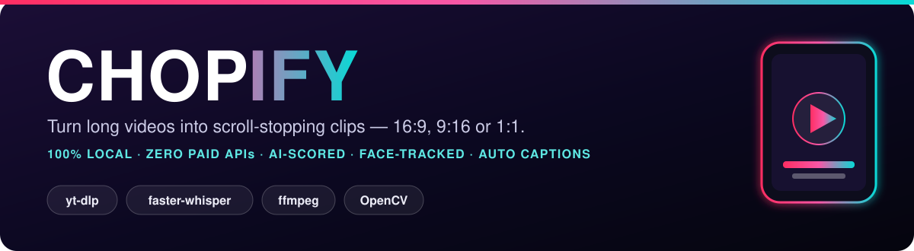

<p align="center"></p>

# Chopify — free, local AI video clipper

**Turn long videos into captioned clips for YouTube Shorts, Instagram Reels, and TikTok, on your own computer.** Chopify is an open-source Python app with a local browser dashboard and a CLI. Import a recording or a video URL, find moments, correct captions, review drafts, and export MP4 clips with SRT subtitles. No subscription, API key, cloud upload, or watermark.

[Get started](#install-and-open-the-dashboard) · [Workflow guide](docs/WORKFLOWS.md) · [Agent/API reference](docs/AGENT-API.md) · [Troubleshooting](docs/TROUBLESHOOTING.md) · [Changelog](CHANGELOG.md)

## What can Chopify do?

| Feature | How it helps |
| --- | --- |
| **Local browser dashboard** | Queue videos, watch job progress, review candidates, edit words and timestamps, and download exports. |
| **Local video input** | Use MP4, MOV, MKV, WebM, M4V, or AVI recordings directly, or download a yt-dlp-supported URL. |
| **Resumable projects** | Reuse matching downloads, transcripts, and completed renders. Retry a failed job without discarding successful clips. |
| **Batch queue** | Add one source per line in Studio or use a JSON list in the CLI. Each video has an isolated project folder. |
| **Caption editor and SRT export** | Fix transcription mistakes before rendering. Burnt captions and SRT files share the same timeline, including tightened cuts. |
| **Reusable brand presets** | Save caption font, text/highlight colors, size, position, and an optional logo in JSON. |
| **Semantic clip search** | Search for a concept such as “handling rejection” using optional local Ollama embeddings, even if those exact words are absent. |
| **Podcast split-screen** | Stack two adjustable horizontal crops in a vertical clip for fixed-camera two-person footage. |
| **Clip selection and review** | Heuristic scoring, optional local LLM scoring, keyword search, numbered selection, editable start/end times, and fast draft previews. |
| **Social video exports** | 16:9, 9:16, or 1:1; H.264 video, AAC when source audio exists; SRT, poster, title/description/hashtag JSON. |
| **Face tracking and cleanup** | Single-frame vertical crops follow a detected face; optional filler/silence removal and audio loudness normalization. |

Clip selection favors sentence endings with punctuation. Scores are editing suggestions, **not predictions or guarantees of virality**. Review the results before publishing.

## Install and open the dashboard

Windows is the primary target. Use **Python 3.11+** and **ffmpeg/ffprobe with libx264, AAC, and subtitle rendering support**. Linux CI also checks the Python and ffmpeg workflows.

```powershell
git clone https://github.com/mehbul/chopify.git
cd chopify
winget install Gyan.FFmpeg
python -m venv .venv
.venv\Scripts\python -m pip install -r requirements.txt
.venv\Scripts\python dashboard.py
```

Studio opens at **http://127.0.0.1:8765**. Paste a local video path or URL, then click **Find clips**. Add multiple sources on separate lines to queue them. After processing, review candidates, edit captions, save your settings, and export selected clips. Stop the server with Ctrl+C. To change the port:

```powershell
.venv\Scripts\python dashboard.py --port 8766 --projects-dir projects
```

The dashboard has no extra web framework or JavaScript installation step. It binds to loopback and is intended for one trusted user on the same computer, not as a public server.

YouTube downloads may also require Deno: `winget install DenoLand.Deno`. A preflight check reports missing Python packages and encoders. Restart your terminal after installing tools so PATH changes take effect.

## CLI: long video to short clips

After installing dependencies, run with the virtual environment's Python (or activate it and use `python`):

```powershell
# Local recording or online video
python chopify.py "C:\Videos\podcast.mp4" --aspect 9:16
python chopify.py "https://youtube.com/watch?v=VIDEO_ID"

# Prepare once, inspect candidates, then render selected clips
python chopify.py "C:\Videos\podcast.mp4" --workdir work --action prepare
python chopify.py --project work --action render --clips 1,3 --preview
python chopify.py --project work --action render --clips 1,3

# Search the transcript using keywords or meaning
python chopify.py "recording.mp4" --search "pricing"
python chopify.py "recording.mp4" --semantic "advice about handling rejection"

# Brand and podcast framing
python chopify.py "podcast.mp4" --brand examples/brand.json --tighten --loudnorm
python chopify.py "podcast.mp4" --aspect 9:16 --layout split --centers 0.25 0.75

# Process a queue of videos into separate projects
python chopify.py --batch examples/batch.json --projects-dir projects
```

CLI single-video runs save state under `work/` and copy the latest exports to `clips/`. Set `--out DIR` or `CHOPIFY_OUT` to change the export folder. Dashboard and batch jobs save outputs inside `projects/<id>/clips/` and drafts inside `previews/`. **Replace the batch sample's sources with your own paths or URLs.**

Successful stages resume by default. Use `--no-resume` to reprocess, or `--project projects/<id> --action render` to retry a batch project. Use `--action render` after manual caption/clip edits; `--action prepare` recalculates candidates when selection inputs change. A failed batch job does not prevent later videos from processing; the CLI exits nonzero if any job fails.

## Semantic search and optional local AI

Default clip selection needs no LLM. For semantic search, install [Ollama](https://ollama.com), run it locally, and download an embedding model:

```powershell
ollama pull nomic-embed-text
python chopify.py "podcast.mp4" --semantic "turning failure into a lesson"
```

The embedding model runs on `127.0.0.1:11434`. Sentence embeddings are cached per transcript/model. Use `--embed-model MODEL` for another compatible local embedding model. Semantic search ranks matches by similarity; it does not guarantee that the topic is present. Missing models produce setup instructions rather than a cloud fallback.

For optional LLM-based selection, download a local chat model separately and pass `--llm MODEL`. If it is unavailable, selection falls back to the heuristic. The GPU backend for faster-whisper is CUDA/NVIDIA; CPU transcription works without an NVIDIA GPU. `--device cpu|cuda|auto` controls transcription.

## Is Chopify an alternative to Opus Clip?

Chopify is a free, MIT-licensed option for creators who want local clipping, captions, reframing, and review. It requires local installation and uses your computer's resources. It does not include cloud collaboration, automatic social publishing, or hosted processing. Compare the workflows and privacy requirements that matter to you; feature sets and pricing of other products change.

## Frequently asked questions

### Does video leave my computer?

Chopify does not upload footage or transcripts to a hosted processing service. Video URLs require downloads. Whisper models download on first use; face tracking may download a YuNet model; optional Ollama models need an initial download. **Local-file processing can run offline once the required dependencies and models are available.**

### Can I correct captions and export subtitles?

Yes. Open a prepared project in Studio, choose **Transcript**, edit word text or start/end times, and **Save captions**. Export again to apply the edits. Each draft and finished clip includes an SRT file relative to that clip's timeline. See the [caption workflow](docs/WORKFLOWS.md#edit-captions-and-export-srt).

### Does split-screen identify who is speaking?

No. Split-screen uses two adjustable horizontal crop centers for a fixed camera and stacks the crops vertically. It is not speaker diarization or automatic two-face tracking. Use a draft to tune the positions before final export.

### What happens if processing fails or Studio closes?

Completed stages and clips remain on disk. Restart Studio and queue the saved project again, or rerun the CLI with `--project PATH`. Interrupted jobs are marked for explicit retry. Changing the source, transcription model, selection settings, words, brand, or render options invalidates the relevant cached work. Do not run two writers against the same project directory at once.

### Can it edit translated or multilingual subtitles?

Whisper detects spoken language, and captions retain its transcription. The heuristic cue lists are English-oriented; punctuation and timing can vary by language. This update does not add translation, bilingual captions, or dubbing. Caption fonts must contain the glyphs you need.

## Developer and agent documentation

- [Workflow guide and project layout](docs/WORKFLOWS.md)
- [CLI, Python interfaces, and local HTTP API](docs/AGENT-API.md)
- [Setup and troubleshooting](docs/TROUBLESHOOTING.md)
- [Machine-readable product facts](docs/product.json) and [llms.txt](llms.txt)
- [Search discovery and documentation deployment](docs/DISCOVERABILITY.md)

```powershell
python -m pip install -r requirements-dev.txt
python -m pytest tests/ -q
python -m compileall -q chopify.py dashboard.py projects.py captions.py branding.py semantic.py download_and_transcribe.py score_clips.py render_clips.py tighten.py
```

Tests include real ffmpeg renders when ffmpeg is installed; speech models and Ollama are not required for the automated suite. Keep videos, transcripts, generated clips, and local brand presets out of Git. Use footage you have permission to process.

Maintained by [mehbul](https://github.com/mehbul). [MIT license](LICENSE). Last documentation update: **2026-10-23**.
