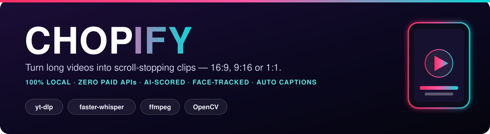
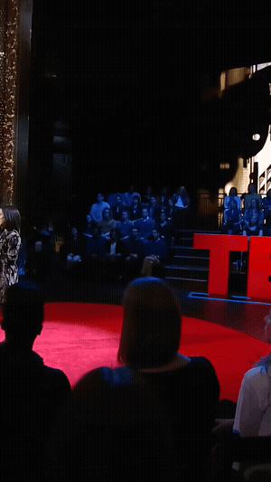

<p align="center"></p>

# Chopify

**Turn long videos into scored, captioned shorts — locally, free, with no uploads or watermarks.**

<p align="center">
  
</p>

<p align="center">
  <a href="#install-in-one-command"><b>Install</b></a> ·
  <a href="https://mehbul.github.io/chopify/"><b>Live tour</b></a> ·
  <a href="CONTRIBUTING.md">Contributing</a> ·
  <a href="LICENSE">MIT License</a>
</p>

<p align="center">
  <a href="https://github.com/mehbul/chopify/actions/workflows/ci.yml"></a>
  <a href="LICENSE"></a>
  
</p>

Chopify is an open-source Python app with a local browser dashboard and a CLI. Import a recording or a video URL, find moments, correct captions, review drafts, and export MP4 clips with SRT subtitles. No subscription, API key, cloud upload, or watermark. The [live site](https://mehbul.github.io/chopify/) is a product tour; the app itself runs on your computer.

[Workflow guide](docs/WORKFLOWS.md) · [Agent/API reference](docs/AGENT-API.md) · [Troubleshooting](docs/TROUBLESHOOTING.md) · [Changelog](CHANGELOG.md)

## What can Chopify do?

| Feature | How it helps |
| --- | --- |
| **Local browser dashboard** | Queue videos, watch job progress, review candidates, edit words and timestamps, and download exports. |
| **Local video input** | Use MP4, MOV, MKV, WebM, M4V, or AVI recordings directly, or download a yt-dlp-supported URL. |
| **Any-length sources** | Podcasts, movies, streams, and gameplay VODs work without a duration setting. Long sources switch to a resumable audio-first path automatically. |
| **Audio and visual discovery** | A local 1 Hz audio timeline boosts reactions, laughs, impacts, and gameplay events, while cached 2 fps visual analysis catches motion spikes, scene/UI changes, faces, and action arcs. Speech-sparse and action-only sources can still produce clips. |
| **Resumable projects** | Reuse matching downloads, transcripts, and completed renders. Retry a failed job without discarding successful clips. |
| **Batch queue** | Add one source per line in Studio or use a JSON list in the CLI. Each video has an isolated project folder. |
| **Caption Studio** | Choose from 13 caption looks, then tune font, size, colors, outline, shadow, cue length, position, box background, and word motion. A live overlay follows the source; automatic emphasis and emoji are optional. |
| **Caption editor and SRT export** | Fix transcription mistakes before rendering. Burnt captions and SRT files share the same timeline, including tightened cuts. |
| **Reusable brand presets** | Save a caption look and optional logo in JSON. A named preset, brand preset, and project override layer in that order. |
| **Semantic clip search** | Search for a concept such as “handling rejection” using optional local Ollama embeddings, even if those exact words are absent. |
| **Podcast split-screen** | Stack two adjustable horizontal crops in a vertical clip for fixed-camera two-person footage. |
| **Clip selection and review** | Absolute 0–10 scoring returns every clip at 8.0+ by default, with an engine-chosen length, optional local LLM reranking, keyword or semantic search, editable times, and fast draft previews. |
| **Social video exports** | 16:9, 9:16, or 1:1; H.264 video, AAC when source audio exists; SRT, poster, title/description/hashtag JSON. |
| **Face tracking and cleanup** | Single-frame vertical crops follow a detected face; optional filler/silence removal and audio loudness normalization. |

Clip selection favors sentence endings with punctuation. Scores are editing suggestions, **not predictions or guarantees of virality**. Review the results before publishing.

## Install in one command

**Windows** (PowerShell):

```powershell
irm https://raw.githubusercontent.com/mehbul/chopify/main/install.ps1 | iex
```

**macOS / Linux:**

```bash
curl -fsSL https://raw.githubusercontent.com/mehbul/chopify/main/install.sh | bash
```

The installer checks Git, Python 3.11+, and ffmpeg, installs anything missing when a package manager is available, clones Chopify into `./chopify`, creates `.venv`, installs the Python dependencies, and opens Studio at **http://127.0.0.1:8765**. Set `CHOPIFY_NO_START=1` to install only, or `CHOPIFY_DIR=/path` to choose the folder.

Prefer to inspect before running? [install.ps1](install.ps1) and [install.sh](install.sh) are short and commented.

<details>
<summary><b>Manual install</b></summary>

Windows is the primary target. Use **Python 3.11+** and **ffmpeg/ffprobe with libx264, AAC, and subtitle rendering support**. Linux CI also checks the Python and ffmpeg workflows.

```powershell
git clone https://github.com/mehbul/chopify.git
cd chopify
winget install Gyan.FFmpeg
python -m venv .venv
.venv\Scripts\python -m pip install -r requirements.txt
.venv\Scripts\python dashboard.py
```

</details>

Studio opens at **http://127.0.0.1:8765**. Paste a local video path or URL, then click **Find clips**. Add multiple sources on separate lines to queue them. After processing, review candidates, edit captions, style them in the **Captions** tab, save your settings, and export selected clips. Stop the server with Ctrl+C. To change the port:

```powershell
.venv\Scripts\python dashboard.py --port 8766 --projects-dir projects
```

The dashboard has no extra web framework or JavaScript installation step. It binds to loopback and is intended for one trusted user on the same computer, not as a public server.

YouTube downloads may also require Deno: `winget install DenoLand.Deno`. A preflight check reports missing Python packages and encoders. Restart your terminal after installing tools so PATH changes take effect.

## CLI: long video to short clips

After installing dependencies, run with the virtual environment's Python (or activate it and use `python`):

```powershell
# Local recording or online video
python chopify.py "C:\Videos\podcast.mp4" --aspect 9:16
python chopify.py "https://youtube.com/watch?v=VIDEO_ID"

# Prepare once, inspect candidates, then render selected clips
python chopify.py "C:\Videos\podcast.mp4" --workdir work --action prepare
python chopify.py --project work --action render --clips 1,3 --preview
python chopify.py --project work --action render --clips 1,3

# Search the transcript using keywords or meaning
python chopify.py "recording.mp4" --search "pricing"
python chopify.py "recording.mp4" --semantic "advice about handling rejection"

# Brand and podcast framing
python chopify.py "podcast.mp4" --brand examples/brand.json --tighten --loudnorm
python chopify.py "podcast.mp4" --aspect 9:16 --layout split --centers 0.25 0.75

# Caption Studio from the CLI
python chopify.py "recording.mp4" --style bold --words-per-cue 2 --caption-position top --emoji --emphasis
python chopify.py "recording.mp4" --caption-json my-caption-style.json

# Process a queue of videos into separate projects
python chopify.py --batch examples/batch.json --projects-dir projects
```

CLI single-video runs save state under `work/` and copy the latest exports to `clips/`. Set `--out DIR` or `CHOPIFY_OUT` to change the export folder. Dashboard and batch jobs save outputs inside `projects/<id>/clips/` and drafts inside `previews/`. **Replace the batch sample's sources with your own paths or URLs.**

Successful stages resume by default. Use `--no-resume` to reprocess, or `--project projects/<id> --action render` to retry a batch project. Use `--action render` after manual caption/clip edits; `--action prepare` recalculates candidates when selection inputs change. A failed batch job does not prevent later videos from processing; the CLI exits nonzero if any job fails.

## How clips are chosen

Chopify evaluates every sentence as a possible start, builds overlapping
candidate windows, and keeps the best natural endpoint for each start. The
duration is chosen by the engine from a ladder that runs from 15 seconds to five
minutes, so a strong moment is not forced into a fixed length.

- The default minimum score is **8.0 on an absolute 0–10 scale**. A clip at
  exactly 8.0 passes and is shown as **8.0+**.
- Every passing clip is returned by default. Use `--max-clips N` only when you
  want a safety cap.
- `--preferred-len` is a soft preference, not a hard cut. The engine can pick a
  shorter or longer natural ending when it scores better.
- The default clip range is **15–300 seconds** (`--min-len` / `--max-len`).
- Interactive runs ask for the minimum score and preferred length once. Pass
  `--min-score` or `--preferred-len` to skip either question, or `--no-input` to
  skip both for scripts and CI.
- Zero passing clips is a real result. Chopify writes an empty selection, reports
  the candidate score range, and does not invent a fallback clip.

```powershell
# Accept only stronger clips, prefer 45-second cuts, and never prompt
python chopify.py "recording.mp4" --min-score 8.5 --preferred-len 45s --no-input

# Interactive --action all prepares first, shows the range, and confirms
# before rendering more than ten clips.
python chopify.py "podcast.mp4" --action all
```

`--explain` prints each candidate's score parts and reason. Prepare writes
`candidates.json` (everything discovered) and `selection.json` (threshold and
range diagnostics); `segments.json` stays the editable render contract used by
the CLI and Studio.

### Audio and visual evidence for sparse sources

Clip discovery also listens to and watches the source. A single local ffmpeg
pass builds a 1 Hz audio timeline (loudness, peaks, spectral flux, and
transients), caches it as `audio_features.npz` beside the transcript, and reuses
it on later prepares. Only candidate ranges are scored against that timeline; no
audio is uploaded.

The engine derives an internal profile (`talk`, `mixed`, or `gameplay/action`)
from speech density, audio variation, and visual activity. The profile changes
duration tie-breaks, evidence weights, and evidence floors. It never changes your
minimum score.

- Speech-sparse clips use a 7.0 text floor and stronger evidence weighting. This
  covers gameplay, streams, and videos with little commentary.
- A source with no transcript words uses detected audio peaks as event seeds,
  with evenly spaced action seeds as a fallback when the track varies without a
  sharp peak. Hooks say `event at 42s`, never a guessed semantic event.
- A source with no words, no audio signal, and a varying picture uses evenly
  spaced visual seeds and is scored from visual evidence alone.
- A flat source with no words and no usable audio or visual evidence fails with
  `No speech and no media evidence; this source cannot be scored.`
- Missing or unreadable video files still fall back to transcript-only scoring,
  so existing projects keep working.

### Visual evidence and silent gameplay

Visual evidence runs locally. A cached ffmpeg decode samples 2 frames per
second at 160x90, and OpenCV measures motion, scene and UI changes, face
presence, event arcs, and boundary quiet. Only the sparse baseline samples (up
to 12 five-second windows) and shortlisted padded candidate ranges are decoded;
results are cached by source identity and range under `visual_sections/`. The
whole-source baseline is cached as `visual_baseline.json`. No frames are
uploaded, and later prepares reuse the cache.

- Visual scoring rewards a motion spike, a scene or UI change, a visible
  facecam, a complete action arc, and quiet boundaries.
- A window whose action arc stays below 0.30 is capped at 6.0, so a static
  screen cannot pass on motion noise alone.
- Facecam stays neutral when the source has no consistent face region.
- Spoken clips keep sentence boundaries. For wordless clips, each boundary can
  move up to 1.5 seconds to the nearest action onset or quiet resolution, and
  only when the combined evidence improves.
- Silent audio is treated as unavailable, not as a zero. Silent gameplay and
  no-commentary PC-game footage can pass from visual evidence alone.
- With both modalities usable, evidence blends 60% audio and 40% visual. A
  single modality is pulled toward neutral. Visual failure falls back to audio,
  then text; if neither modality is usable, scoring uses text alone.

The score is still an editing suggestion, not a prediction of virality.

### Very long sources and gameplay VODs

There is no long-video toggle and no fixed duration ceiling. A source uses the
long path when it is at least **2 hours**, its estimated download is at least
**8 GB**, or its duration cannot be determined. Everything else keeps the
original short-source behavior.

- Long URLs download audio only. If the source has no audio, or its audio track
  contains no speech, Chopify downloads the lowest-resolution video instead and
  scores it from visual evidence.
- Transcription runs in 30-minute chunks with a 30-second overlap. Completed
  chunks are saved as `transcript.partNNN.json`, so an interrupted job resumes
  instead of restarting.
- Discovery scans 30-minute ownership blocks and reads up to `--max-len` of
  context across each boundary. Completed blocks cache as
  `candidates.partNNN.json`.
- Rendering downloads only the selected ranges. Nearby clips share one padded
  section (10 seconds of padding, clips within 30 seconds merged, 10-minute cap);
  a single longer clip keeps its full range.
- Local long files render directly and never re-download. Long URL sections cache
  under `sections/`; previews keep them, and a successful final render removes
  them.
- In Studio, **Watch** on a long URL candidate renders a 480p draft from just that
  section, plays it, and keeps candidate edits. A project with a full local video
  seeks the source player instead.
- If one section fails, other clips still render and successful outputs are
  kept. The failed ranges stay cached for a later retry.
- Global clip times, `segments.json`, caption timings, brand JSON, and default
  16:9 output are unchanged.

## Semantic search and optional local AI

Default clip selection needs no LLM. For semantic search, install [Ollama](https://ollama.com), run it locally, and download an embedding model:

```powershell
ollama pull nomic-embed-text
python chopify.py "podcast.mp4" --semantic "turning failure into a lesson"
```

The embedding model runs on `127.0.0.1:11434`. Sentence embeddings are cached per transcript/model. Use `--embed-model MODEL` for another compatible local embedding model. Semantic search ranks matches by similarity; it does not guarantee that the topic is present. Missing models produce setup instructions rather than a cloud fallback.

For optional LLM-based selection, download a local chat model separately and pass `--llm MODEL`. If it is unavailable, selection falls back to the heuristic. The GPU backend for faster-whisper is CUDA/NVIDIA; CPU transcription works without an NVIDIA GPU. `--device cpu|cuda|auto` controls transcription.

## Is Chopify an alternative to Opus Clip?

Chopify is a free, MIT-licensed option for creators who want local clipping, captions, reframing, and review. It requires local installation and uses your computer's resources. It does not include cloud collaboration, automatic social publishing, or hosted processing. Compare the workflows and privacy requirements that matter to you; feature sets and pricing of other products change.

## Frequently asked questions

### Does video leave my computer?

Chopify does not upload footage or transcripts to a hosted processing service. Video URLs require downloads. Whisper models download on first use; face tracking may download a YuNet model; optional Ollama models need an initial download. **Local-file processing can run offline once the required dependencies and models are available.**

### Can I correct captions and export subtitles?

Yes. Open a prepared project in Studio, choose **Transcript**, edit word text or start/end times, and **Save captions**. Export again to apply the edits. Each draft and finished clip includes an SRT file relative to that clip's timeline. See the [caption workflow](docs/WORKFLOWS.md#edit-captions-and-export-srt).

### Can I style and animate captions?

Yes. Open a prepared project, choose **Captions**, and start from one of 13 presets: `default`, `clean`, `minimal`, `bold`, `boxed`, `karaoke`, `pop`, `neon`, `typewriter`, `retro`, `hormozi`, `mrbeast`, or `podcast`. Adjust font, size, margin, colors, outline, shadow, box background, words per cue, position, motion, and word highlighting. **Preview 5s** plays a selected clip range with the overlay.

The overlay approximates the libass render; the exported MP4 is authoritative. Style precedence is named preset, then brand preset, then the project's caption override. **Save as preset** stores a reusable named look under Brand presets. Automatic emphasis colors up to two numbers, money amounts, ALL-CAPS words, or power words per cue. Emoji adds one relevant emoji per cue when a rule matches, and glyphs depend on an installed system emoji font.

### Does split-screen identify who is speaking?

No. Split-screen uses two adjustable horizontal crop centers for a fixed camera and stacks the crops vertically. It is not speaker diarization or automatic two-face tracking. Use a draft to tune the positions before final export.

### What happens if processing fails or Studio closes?

Completed stages and clips remain on disk. Restart Studio and queue the saved project again, or rerun the CLI with `--project PATH`. Interrupted jobs are marked for explicit retry. Changing the source, transcription model, selection settings, words, brand, or render options invalidates the relevant cached work. Do not run two writers against the same project directory at once.

### Can it edit translated or multilingual subtitles?

Whisper detects spoken language, and captions retain its transcription. The heuristic cue lists are English-oriented; punctuation and timing can vary by language. This update does not add translation, bilingual captions, or dubbing. Caption fonts must contain the glyphs you need.

## Developer and agent documentation

- [Workflow guide and project layout](docs/WORKFLOWS.md)
- [CLI, Python interfaces, and local HTTP API](docs/AGENT-API.md)
- [Setup and troubleshooting](docs/TROUBLESHOOTING.md)
- [Machine-readable product facts](docs/product.json) and [llms.txt](llms.txt)
- [Search discovery and documentation deployment](docs/DISCOVERABILITY.md)

```powershell
python -m pip install -r requirements-dev.txt
python -m pytest tests/ -q
python -m compileall -q chopify.py dashboard.py projects.py captions.py branding.py semantic.py download_and_transcribe.py score_clips.py render_clips.py tighten.py
```

Tests include real ffmpeg renders when ffmpeg is installed; speech models and Ollama are not required for the automated suite. Keep videos, transcripts, generated clips, and local brand presets out of Git. Use footage you have permission to process.

## Contributing

Issues and pull requests are welcome. Read [CONTRIBUTING.md](CONTRIBUTING.md) for setup, tests, and review expectations, and use [GitHub Discussions](https://github.com/mehbul/chopify/discussions) for questions and ideas.

## License

MIT — see [LICENSE](LICENSE). You can use, fork, and ship Chopify; attribution and a link back are appreciated.

Maintained by [mehbul](https://github.com/mehbul). Last documentation update: **2026-11-04**.
